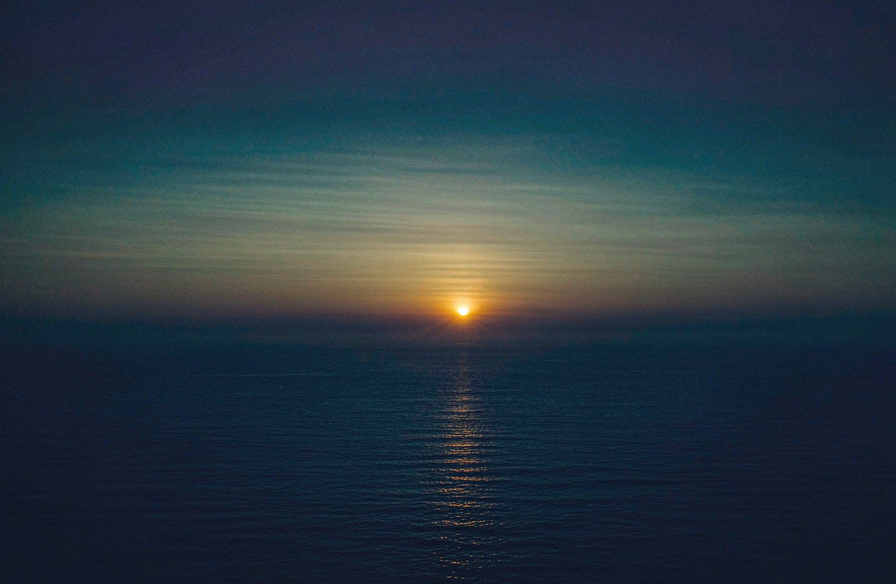
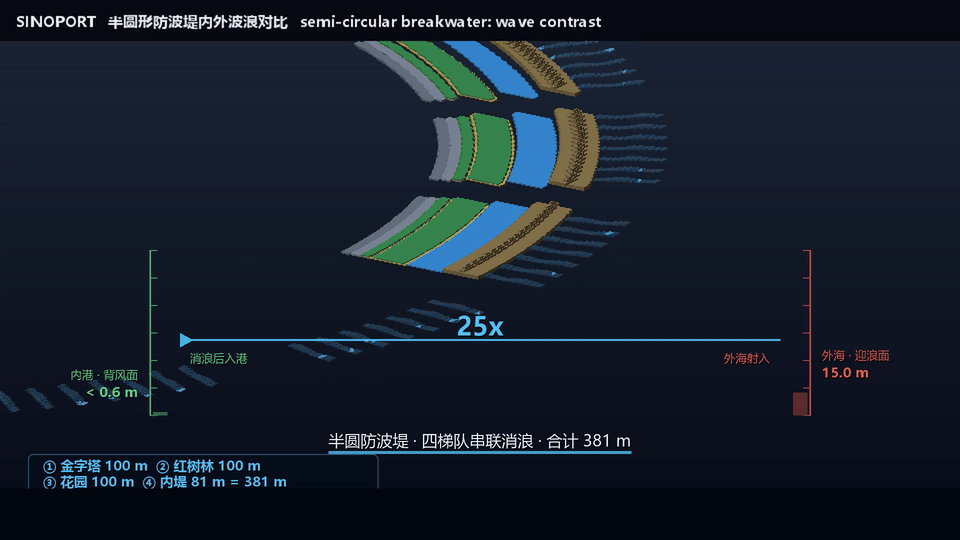

<!-- SINOSHOP GALAXY NAV:BEGIN -->

> 🌐&nbsp;[Project Homepage](https://sinoshop-open.github.io/webpage/) ｜ 🚀&nbsp;[SINOSFT Main Repository](https://github.com/SINOSHOP-OPEN/sinosft) ｜ 🌊&nbsp;[SINOTIDE Algorithm Repository](https://github.com/SINOSHOP-OPEN/SinoTide) ｜ ⚓&nbsp;[SINOPORT Floating Port](https://github.com/SINOSHOP-OPEN/SinoPORT) ｜ 🧪&nbsp;[Simulation & Verification Repository](https://gitee.com/sinoshop/Sinoport-public)

> ⚓ **This repository is the floating-port scenario of the [SINOSFT main repository](https://github.com/SINOSHOP-OPEN/sinosft); the main repository lives there.**

<!-- SINOSHOP GALAXY NAV:END -->

<!-- SINOSHOP LANG SWITCH:BEGIN -->

> 🌏 **Language** ｜ [简体中文](./README.md) ｜ English (this page)

<!-- SINOSHOP LANG SWITCH:END -->

## 🌊 SINOSHOP · Core Creed of Ocean Civilisation

### Observe Nature's Order, Align with Ocean's Rhythm.

*When the Three Harmonies Are Balanced, the Three Realms Rest Secure.*

**Ocean Generates Power · Power Sustains Ships · Ships Erect Bridges · Bridges Build Cities · Cities Bless the People**

*Steadfast Loyalty glowing like the sun and moon; Benevolence nourishing the tide of time.*

# SinoPORT

### A floating harbour that drives no piles into the seabed

*Digital-twin-driven marine energy infrastructure*

**🎬 108-second technical showcase** — auto-looping GIF · the 25× wave-height comparison shot at the semi-circular breakwater

**▶ The full 108 s film** → [high-resolution MP4, inside this repository](showcase/SINOPORT_Tech_Showcase_108s.mp4)

 

**[Wave attenuation (verify_01)](https://gitee.com/sinoshop/Sinoport-public/blob/master/verify/public_verify_01_wave_attenuation_381m.py)**　·　
**[Load cancellation (verify_02)](https://gitee.com/sinoshop/Sinoport-public/blob/master/verify/public_verify_02_lcs_load_cancellation.py)**　·　
**[Dataset self-consistency check](https://gitee.com/sinoshop/Sinoport-public/blob/master/verify/verify_public_dataset.py)**

**[All 15 verification lines · source in verify/](https://gitee.com/sinoshop/Sinoport-public/tree/master/verify)**

Every link above opens a rendered source page on Gitee — nothing to download, nothing to unzip, no dead ends.

---

## What this repository is

| Path | Content |
|:--|:--|
| `showcase/` | The front page: the 108-second technical film and the 5-second looping preview |
| `media/seascape/` | Visual material — the deep-blue seascape the project is set against |
| `verify/` | A small public script that checks this repository's published dataset against itself |
| `CONTRIBUTING.md` | How to take part, and how contribution is recorded |

Piled foundations are a real engineering achievement, and on many coasts they remain the right answer. In deep water and on soft seabed they also carry an ecological and construction cost that is hard to avoid. SinoPORT sets out a different route — **flotation**: vertical load is carried by buoyancy, impact is absorbed flexibly, and the weight is handed back to the sea instead of being pressed onto the structure.

## How it holds still

| Principle | What it means for a working harbour |
|:--|:--|
| **Energy self-sufficiency** | Waves and wind are treated as inputs, not merely as loads: extreme sea states are turned into power the harbour uses itself. |
| **Flexible load stability** | With berths full and weather heavy, the working deck stays level enough to keep working — no visible motion at the quay line. |
| **Open verification** | Every claim is published next to the script that tests it, so anyone can disagree in public and settle the question by running code. |

## What is public, and what is not

**Published**: the macro form of the system, the public drawings, the films, and the reproducible verification layer.

**Not published**: the core control algorithms, the structural design, and the engineering geometry configuration. The load-adaptive architecture is patent-protected and its control laws stay internal.

> **We give conclusions, not the bottom card.** What is public is the part that numbers can prove.

---

## B · Verification

**Code mirror · [Sinoport-public](https://gitee.com/sinoshop/Sinoport-public)** — the same verification layer in its own public repository. Two doors, both opening onto the same room.

> 🧪 **All underlying physics logic and verification scripts can be reproduced in one command in the [Simulation & Verification Repository (Sinoport-public)](https://gitee.com/sinoshop/Sinoport-public).**

- [👉 The 15 verification lines, rendered source](https://gitee.com/sinoshop/Sinoport-public/blob/master/verify/run_all_public_verifications.py)
- [👉 Assertion results as JSON](https://gitee.com/sinoshop/Sinoport-public/blob/master/verify/verify_01_summary.json)
- [👉 Line-by-line link list (verification repository README)](https://gitee.com/sinoshop/Sinoport-public#readme)

> **A person may write copy, but may not write PASS.** Every judgement lives in the scripts — if one assertion fails, the run stops with a non-zero exit code.

All links above are rendered source pages on Gitee: syntax highlighting, no download, no archive.

---

2026 Beijing Open-Source Innovation Competition · Open-Source Intelligent Hardware Solutions Track
