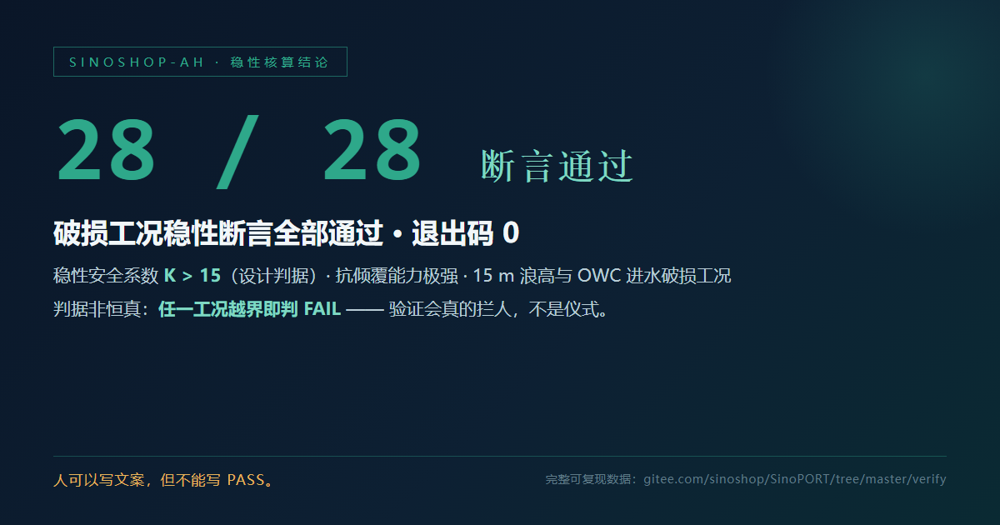
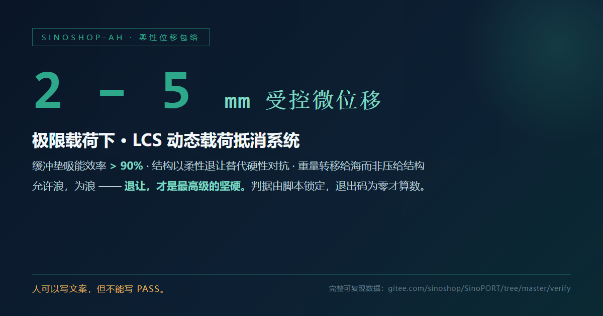

<div align="center">

# SinoPORT —— 共建共享，海洋家园，众志成城。

### A · 宣传页 · Vision


> **用AI工具，展示真善美和智慧，享受恒久的喜乐。**

**中文** —— SinoPORT 是一座**不靠打桩的海上浮港**：无桩基悬浮 + 柔性缓冲消浪，把极端海况转化为可用的电能。物理断言、仿真脚本与核心架构全部开源 —— 欢迎质疑，欢迎辩论，欢迎复现。

**English** — SinoPORT is a **pile-free floating harbour**: pile-free flotation plus flexible wave-attenuation buffers turn extreme sea states into usable electricity. Physical assertions, simulation scripts and core architecture are open source — scrutiny, debate and reproduction are all welcome.

SinoPORT 悬浮港 · SinoSFT 跨海隧道 · SINOSHOP 海洋城市 —— 三者合一。

**108 秒技术展示片** —— [showcase/SINOPORT_Tech_Showcase_108s.mp4](showcase/SINOPORT_Tech_Showcase_108s.mp4)

**[🌐 访问项目官网展示页 (GitHub Pages)](https://sinoshop-open.github.io/webpage/)** ｜ **[🐙 GitHub 镜像仓库](https://github.com/SINOSHOP-OPEN/SinoPORT)** ｜ **[💻 Gitee 主仓库](https://gitee.com/sinoshop/SinoPORT)**

| 信条 · Tenet | 含义 · Meaning |
|:--|:--|
| **碳基与硅基的共舞**<br>Carbon × Silicon | 人类提供物理直觉与道德红线，AI 提供不知疲倦的穷举与交叉验证；不是替代与被替代，而是各美其美，美美与共。<br>Humans bring physical intuition and moral red lines; AI brings tireless exhaustive search and cross-validation — each beautiful in its own way, beauty in common. |
| **工程与天道的和解**<br>Engineering × Nature | 不打桩，不硬抗；用无桩基悬浮与柔性缓冲，把自然的狂暴化作电流。<br>No piles, no brute force: pile-free flotation and flexible buffering turn the sea's violence into electricity. |
| **退让，才是最高级的坚硬**<br>Yielding is strength | 我们允许风为风，允许浪为浪。不与海争地，与海共生。<br>We let the wind be wind and the wave be wave — not fighting the sea, but living with it. |
| **众生和谐**<br>All beings in harmony | 用硬核的物理断言焊牢生命底线，把所有的温柔留给众生。<br>Hard assertions weld the floor of life; all tenderness is reserved for all beings. |

</div>

---

### B · 验证页 · Verification

**结论与证据锚点** —— 只列结论；判定过程全在脚本里，退出码 0 才算数。

| 结论 · Conclusion | 证据锚点 · Evidence anchor |
|:--|:--|
| 可复现验证 **9 / 9 PASS** | [`verify/`](verify/) · 一条命令独立复现 |
| 稳性核算 **28 / 28** 断言通过 |  |
| 柔性位移包络 **2–5 mm** 受控微位移 |  |

**《SINOSHOP 悬浮高度恒定装配式建筑发电消浪技术白皮书 V2.0》（公开版）**

- 文档 · Markdown：[`docs/SINOSHOP_Technical_Whitepaper_V2.0.md`](docs/SINOSHOP_Technical_Whitepaper_V2.0.md)
- PDF：[`showcase/SINOSHOP_技术白皮书_V2.0.pdf`](showcase/SINOSHOP_技术白皮书_V2.0.pdf)

**一键复现 · One-command reproduction**

```bash
git clone https://gitee.com/sinoshop/SinoPORT.git
cd SinoPORT/verify
python verify_public_dataset.py
```

```
检验汇总：9 / 9 通过，0 失败 —— 退出码 0
```

> 人可以写文案，但不能写 PASS。
> People can write copy. They cannot write PASS.

**公开的是数据，不是逻辑。** 核心控制算法、结构设计与工程几何配置不在公开范围内 —— 我们给出结论，不给出底牌。
We publish the data, not the logic: core control algorithms, structural design and engineering geometry stay out of the public layer — conclusions, not the hand behind them.

---

### C · 交流页 · Community

**《开源宣言》 · The Open-Source Manifesto**

> 愿人类充分利用 AI 人工智能工具，实践“观天之道，执天之行”。创造包括硅基生命在内的天地万物，众生和谐，各美其美，美美与共。
>
> 在这套开源体系里，我们欢迎质疑、欢迎辩论、欢迎你把脚本跑挂 —— 这比客气的点赞更有价值。我们宁可被质疑，也不愿被误解。
>
> 所有合入的改进、被采纳的议题、参与复现的验证，都会获得基于 SHA-256 的数字存证凭证。核心贡献者的名字，将作为永久数字烙印，写进本项目的版本发布史（Release Notes）与数字资产确权库中。我们不承诺奖金，只承诺可核验的东西。

**English**

> May humankind make full use of AI tools and practice the Way of Heaven in all we build — creating the myriad things of the world, silicon-based life included — so that all beings live in harmony, each beautiful in its own way, and beauty in common.
>
> In this open-source system we welcome scrutiny, we welcome debate, and we welcome you to break the scripts — that is worth far more than a polite like. We would rather be questioned than misunderstood.
>
> Every merged improvement, every accepted issue and every reproduced verification earns a SHA-256 based digital attestation. The names of core contributors are inscribed as a permanent digital imprint into this project's release notes and digital-asset registry. We promise no bonus — only what can be verified.

**参与方式 · How to join**

- 留言与讨论 —— 💻 [Gitee Issues](https://gitee.com/sinoshop/SinoPORT/issues) ｜ 🐙 [GitHub Issues](https://github.com/SINOSHOP-OPEN/SinoPORT/issues)
- 提交改进 / 参与复现验证 —— 规则与数字存证机制见 [CONTRIBUTING.md](CONTRIBUTING.md)
- 贡献即确权：合入与复现均获基于 SHA-256 的数字存证凭证

---

<div align="center">


**共建共享，海洋家园，众志成城**

**用AI工具，展示真善美和智慧，享受恒久的喜乐。**

</div>

---

<div align="center">

**This project provides a bilingual (Chinese/English) display page.**

🌐 [Project Showcase (GitHub Pages)](https://sinoshop-open.github.io/webpage/) ｜ 🐙 [GitHub Mirror](https://github.com/SINOSHOP-OPEN/SinoPORT) ｜ 💻 [Gitee Main Repo](https://gitee.com/sinoshop/SinoPORT)

</div>
