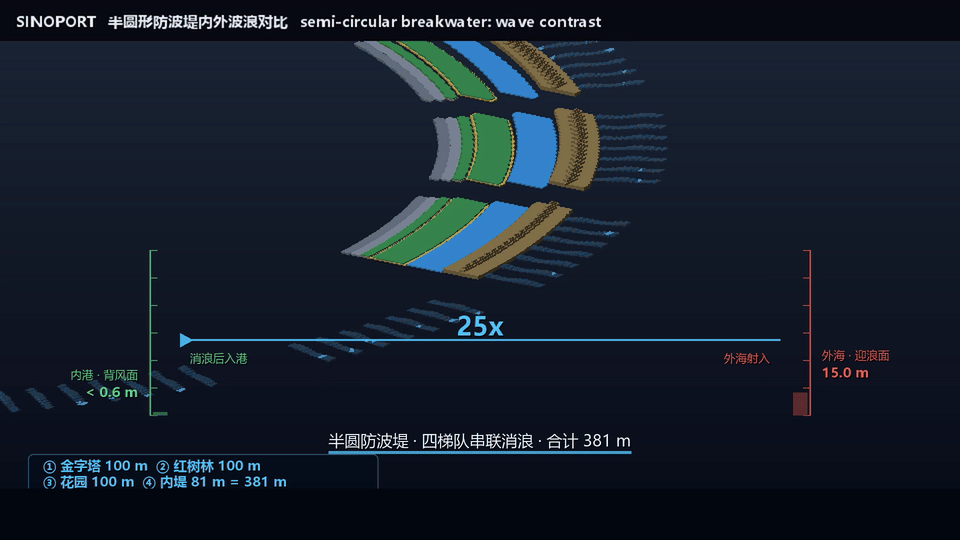

<!-- SINOSHOP GALAXY NAV:BEGIN -->

> 🌐 [项目官网](https://sinoshop-open.github.io/webpage/) ｜ 🚀 [SINOSFT 主仓](https://github.com/SINOSHOP-OPEN/sinosft) ｜ 🌊 [SINOTIDE 算法仓](https://github.com/SINOSHOP-OPEN/sinotide) ｜ ⚓ [SINOPORT 悬浮港](https://github.com/SINOSHOP-OPEN/SinoPORT) ｜ 🧪 [代码仿真验证仓](https://gitee.com/sinoshop/Sinoport-public)

> ⚓ **本仓库为 [SINOSFT 主仓](https://github.com/SINOSHOP-OPEN/sinosft) 的悬浮港场景，主仓请见 [SINOSFT](https://github.com/SINOSHOP-OPEN/sinosft)。**

<!-- SINOSHOP GALAXY NAV:END -->

<!-- CREED:START -->
<!-- ◆ 20261029 核心纲领置顶 -->

## 🌊 SINOSHOP · 海洋文明核心纲领

**CORE PRINCIPLE OF OCEAN CIVILISATION**

---

**【核心纲领 Core Principle】**

### 观天之道，执天之行，三盗既宜，三才既安。

*Observe Nature's Order, Align with Ocean's Rhythm. When the Three Harmonies Are Balanced, the Three Realms Rest Secure.*

**【工程哲学 Industrial Philosophy】**

### 海生电、电养船、船搭桥、桥造城、城惠民。航天海，众生安。

*Ocean Generates Power, Power Sustains Ships, Ships erect Bridges, Bridges Build Cities, Cities bless the People, Space-Ocean Synergy, All dwell in security.*

**【精神信念 Spiritual Belief】**

### 贞忠昭日月，惠民播春秋。

*Steadfast Loyalty glowing like the sun and moon; Benevolence nourishing the tide of time.*

<!-- CREED:END -->

# SinoPORT

**🎬 108 秒技术展示片 · 动态预览**（GIF 自动循环 · 半圆弧破波堤 25× 波高对比镜头）

**🎬 想看完整版 108 秒大片？** —— [▶ 点击此处获取高清视频（Gitee 仓内文件）](showcase/SINOPORT_Tech_Showcase_108s.mp4)

 

**[查看波浪衰减验证代码 (verify_01)](https://gitee.com/sinoshop/Sinoport-public/blob/master/verify/public_verify_01_wave_attenuation_381m.py)**　·　
**[查看载荷抵消验证代码 (verify_02)](https://gitee.com/sinoshop/Sinoport-public/blob/master/verify/public_verify_02_lcs_load_cancellation.py)**　·　
**[查看数据自洽性检验 (verify_public_dataset)](https://gitee.com/sinoshop/Sinoport-public/blob/master/verify/verify_public_dataset.py)**

**[全量 15 条验证主线 · 代码仓 verify/ 目录（点开即看）](https://gitee.com/sinoshop/Sinoport-public/tree/master/verify)**

以上链接仅指向 Gitee 代码渲染页，无需下载即可浏览，彻底告别 404。

---

## B · 验证页 · Verification

**代码仓镜像 · [Sinoport-public](https://gitee.com/sinoshop/Sinoport-public)** —— 同一套验证层的独立公开代码仓，两扇门都能进。

> 🧪 **所有底层物理逻辑与验证脚本，请在 [代码仿真验证仓 Sinoport-public](https://gitee.com/sinoshop/Sinoport-public) 中一键复现。**

- [👉 点击查看 15 条验证主线代码（在线预览）](https://gitee.com/sinoshop/Sinoport-public/blob/master/verify/run_all_public_verifications.py)
- [👉 点击查看 361 项断言核验结果 JSON](https://gitee.com/sinoshop/Sinoport-public/blob/master/verify/verify_01_summary.json)
- [👉 15 条主线逐条直链清单（代码仓 README）](https://gitee.com/sinoshop/Sinoport-public#readme)

> **人可以写文案，但不能写 PASS。** 判据全在脚本里 —— 任一条断言不成立，脚本即以非零退出码中止。

以上链接均为 Gitee 代码渲染页，点开即见带语法高亮的源码，无需下载、无需解压。

---

2026 北京开源创新赛 · 开源智能硬件解决方案赛道
